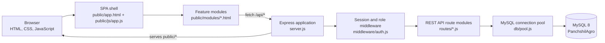
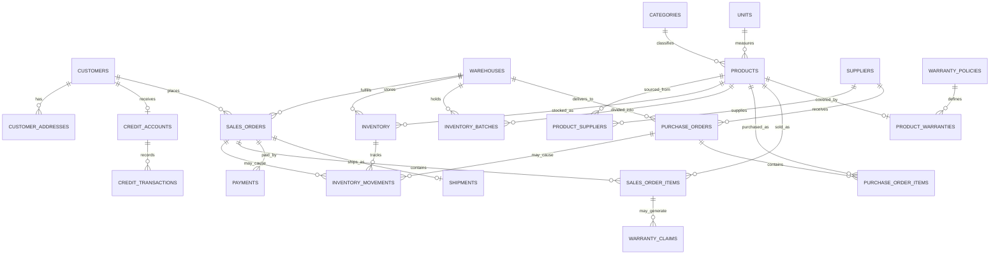

# Panchshil Agro Management

A browser-based inventory and credit-management application for an agricultural supply shop. It uses a plain HTML/CSS/JavaScript frontend, a Node.js/Express API, and a MySQL database.

## Architecture



### Request and startup flow

1. `server.js` loads environment variables, configures Express JSON/form parsing, cookie-based sessions, and serves the `public/` directory.
2. Before listening, the server verifies MySQL access, runs `db/ensureAppSchema.js`, and ensures the `app_user` login table exists. The schema setup adds the app-specific product brand, price audit, and inventory batch tables and copies current aggregate inventory into opening batches where needed.
3. The login page sends credentials to `POST /api/login`. Passwords are checked against bcrypt hashes in `app_user`; the authenticated user's ID, username, and role are kept in the session.
4. The SPA shell loads feature HTML modules into `#moduleContainer`. Module scripts call the same-origin `/api/*` endpoints and render the returned JSON.
5. `requireLogin` protects feature APIs, and `requireRole` applies additional role restrictions. Routes use the shared MySQL pool and parameterized queries.

## Application modules and API

| Frontend module | API prefix | Purpose |
|---|---|---|
| Dashboard | `/api/dashboard` | Business totals, category, supplier, payment, and credit summaries |
| Suppliers | `/api/suppliers` | Supplier directory and maintenance |
| Customers | `/api/customers` | Customer records, addresses, search, filters, and customer codes |
| Products | `/api/products` | Product catalog, supplier costs, and price audit history |
| Inventory | `/api/inventory` | Batch stock, warehouse totals, expiring stock, and godown-to-shelf transfers |
| Credit | `/api/credit` | Credit charges, balances, overdue reporting, and entries |
| Payments | `/api/payments` | Payment records, customer totals, and outstanding balances |
| Warranty | `/api/warranty` | Warranty claims and claim-status updates |
| Views & Routines | `/api/routines` | Database views, stored routines, and helper queries |
| DB Users & Privileges | `/api/privileges` | MySQL grants and privilege demonstrations (admin only) |
| SQL log | `/api/sql` | SQL log endpoint |
| Authentication | `/api/login`, `/api/logout`, `/api/me` | Login, logout, and current session |

Feature routes are registered in `server.js`; their implementations are in `routes/`. Static module pages live in `public/modules/`, with shared SPA navigation and module loading in `public/js/app.js`.

## Database architecture

The application targets the normalized MySQL 8 schema created by `PanchshilAgro_Complete (1).sql`. Important entities and relationships:

- **Customers and credit:** `customers` has customer identity and contact fields; `customer_addresses` stores addresses. Each customer can have a `credit_accounts` record with a ledger in `credit_transactions` (`CHARGE`, `PAYMENT`, or `ADJUSTMENT`). `v_credit_balances` derives outstanding and available credit.
- **Catalog and suppliers:** `products` reference `categories` and `units`. Products and suppliers are many-to-many through `product_suppliers`, which stores quoted costs. `product_brands` stores the optional brand field used by the app.
- **Warehouses and inventory:** `inventory` stores the total quantity for each warehouse/product pair. `inventory_batches` stores batch number, expiry, shelf quantity, and godown quantity; its rows contribute to the warehouse/product total. `inventory_movements` records stock adjustments and other stock events.
- **Purchasing:** `purchase_orders` and `purchase_order_items` record supplier purchases and their products.
- **Sales and payments:** `sales_orders` and `sales_order_items` record customer orders; `payments` are associated with sales orders; `shipments` track delivery.
- **Warranty:** `warranty_policies` and `product_warranties` describe product coverage; `warranty_claims` ties a claim to an order and product.
- **Application access and audit:** `app_user` stores web login hashes and roles. `product_price_audit` records product price changes.
- **Reporting objects:** the main schema also defines views, functions, procedures, and triggers. The dashboard and routines modules use these alongside direct queries.

### Entity relationship diagram

The solid relationships below are enforced by foreign keys in the main SQL schema. `inventory_batches`, `product_brands`, and `product_price_audit` are app-support tables created by `db/ensureAppSchema.js`; their associations are maintained by the application.



### Schema files

> **Important:** Do not run these SQL files interchangeably. They describe different generations of the database.

- **Application schema:** `PanchshilAgro_Complete (1).sql` is the schema expected by the app. It starts with `DROP DATABASE IF EXISTS PanchshilAgro` and permanently deletes an existing database with that name. Only run it when intentionally creating a fresh database and after backing up any data.
- **Legacy practical schema:** `PanchshilAgro_MySQL.sql` creates a different, seven-table schema. It does not contain the normalized tables expected by the application.
- **Legacy practical routines:** `PanchshilAgro_Practical_4.sql` targets the seven-table schema above. It truncates/reloads data and recreates objects; it is not the application schema setup.

Use the application schema for this web app. Do not execute the legacy practical scripts against the app database unless you intentionally want to rebuild/migrate the database and have reviewed their effects.

## Project layout

```text
.
├── db/
│   ├── app_user.sql           # Web login table definition
│   ├── ensureAppSchema.js     # App-specific schema setup and opening-batch migration
│   ├── pool.js                # Shared mysql2 promise pool
│   └── seedAppUsers.js        # Seeds demo logins
├── middleware/
│   └── auth.js                # Login and role checks
├── public/
│   ├── app.html               # SPA shell and navigation
│   ├── login.html
│   ├── css/style.css
│   ├── js/app.js              # SPA navigation and module loader
│   ├── js/login.js
│   └── modules/               # Dashboard and feature screens
├── routes/                    # Express API route modules
├── .env.example               # Environment variable template
├── package.json
├── server.js                  # Express app and startup sequence
└── PanchshilAgro_Complete (1).sql
```

## Requirements

- Node.js 18 or later
- MySQL 8.0.16 or later
- A MySQL account with access to the application database and permission to create the app's supporting tables on first startup

## Run locally

1. Create a backup of any existing database named `PanchshilAgro`.
2. To create a fresh database, run `PanchshilAgro_Complete (1).sql` in MySQL Workbench or another MySQL client. **This script drops and recreates the database.**
3. Copy `.env.example` to `.env` and set your MySQL connection values and a long, unique `SESSION_SECRET`.

   ```powershell
   Copy-Item .env.example .env
   ```

4. Install dependencies and start the app:

   ```powershell
   npm install
   npm start
   ```

5. Open [http://localhost:3000](http://localhost:3000).

Optional: run `npm run seed:users` to create or reset the demo login accounts. Demo credentials are defined in `db/seedAppUsers.js`; change them before using the app outside a local demonstration. The server creates demo users at startup only if `app_user` is empty.

## Configuration

| Variable | Purpose | Default |
|---|---|---|
| `DB_HOST` | MySQL host | `localhost` |
| `DB_PORT` | MySQL port | `3306` |
| `DB_USER` | MySQL username | `root` |
| `DB_PASSWORD` | MySQL password | Empty |
| `DB_NAME` | Database name | `PanchshilAgro` |
| `SESSION_SECRET` | Session signing secret | Development fallback; set a unique secret |
| `PORT` | HTTP port | `3000` |

## Roles

The supported web roles are `admin`, `staff`, and `accountant`. The frontend hides controls that are not available to the current role, but authorization is also enforced on the API. Individual write operations have route-specific role requirements; review `routes/` and `middleware/auth.js` for the current rules.

## Security and deployment notes

- Keep `.env`, passwords, and local notes out of Git. `.env.example` is a template and should contain placeholders only.
- Change demo credentials and use a strong `SESSION_SECRET` before deployment.
- The default Express session store is in-memory and is intended for local development/demonstrations. Use a persistent session store for production.
- Serve production traffic over HTTPS and configure secure cookies, database least-privilege access, backups, and appropriate monitoring before deployment.
- SQL uses `mysql2` parameter placeholders for user-supplied values. Do not build SQL statements from untrusted input.

## Development

```powershell
npm run dev
```

The project currently does not define a test or lint script in `package.json`.
